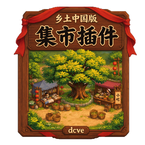
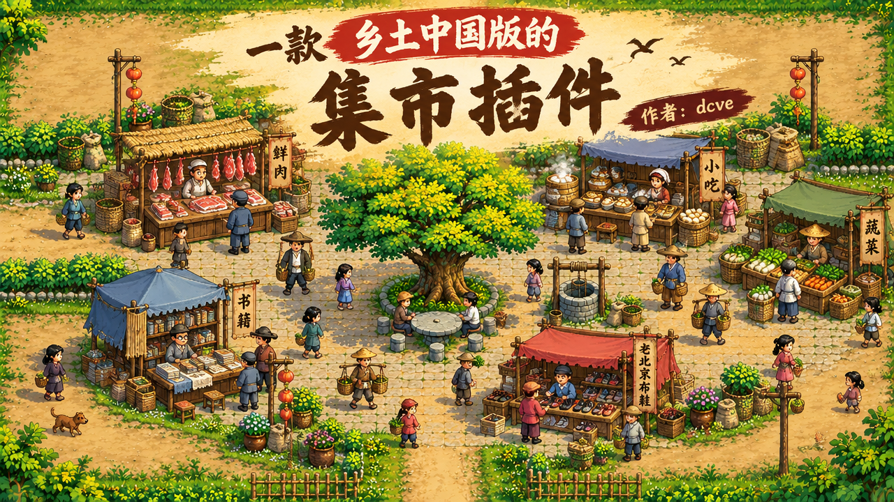

  

<h1 align="center">集市-online</h1>

  一款乡土中国版的<b>集市经营插件</b>——内嵌在论坛里的宋代市井风小游戏。 
  在你自己的站里圈一块地：玩家租铺上货，交子铺存钱生息，亥时一到，自动散集。

  <a href="https://github.com/fdhrthrth/pixel_market/releases/download/v1.2.0/jishi.zip">下载 jishi.zip</a> ·
  <a href="https://github.com/fdhrthrth/pixel_market">GitHub 仓库</a> ·
  <a href="https://zero01.cyou/">zero01.cyou</a>

> 想暴富，先租铺。

---

## 简介

「集市」是一个装进论坛的**集市经营小游戏**。站点管理员进站即「村长」，可以自定义地图、圈地出租；普通玩家首次进入只选一个性别（名字沿用论坛用户名），之后就能租铺面、摆货架、挂商品卡片，把积分换成铜钱，再存进交子铺吃利息。

|          |                                                            |
| -------- | ---------------------------------------------------------- |
| 形态     | 单文件插件（`plugin.php` 约 9,455 行）+ `assets/` 素材目录 |
| 运行环境 | 宿主论坛的插件体系，仅需 PHP                               |
| 数据库   | SQLite / MySQL / PostgreSQL，同一套读写                    |
| 渲染     | Canvas 视口 960×540 设计像素，整页等比缩放，像素不插值     |
| 素材     | 122 项（118 张像素图 + 2 段音乐 + 2 份清单），约 8.9 MB    |
| 版本     | v1.2.0                                                     |
| 作者     | dcve                                                       |

## 许可与联系

本项目以 **MIT License** 开源，详见 [LICENSE](./LICENSE)。

- 仓库与发布：<https://github.com/fdhrthrth/pixel_market>
- 作者：dcve
- 更多请关注：<https://zero01.cyou/>
